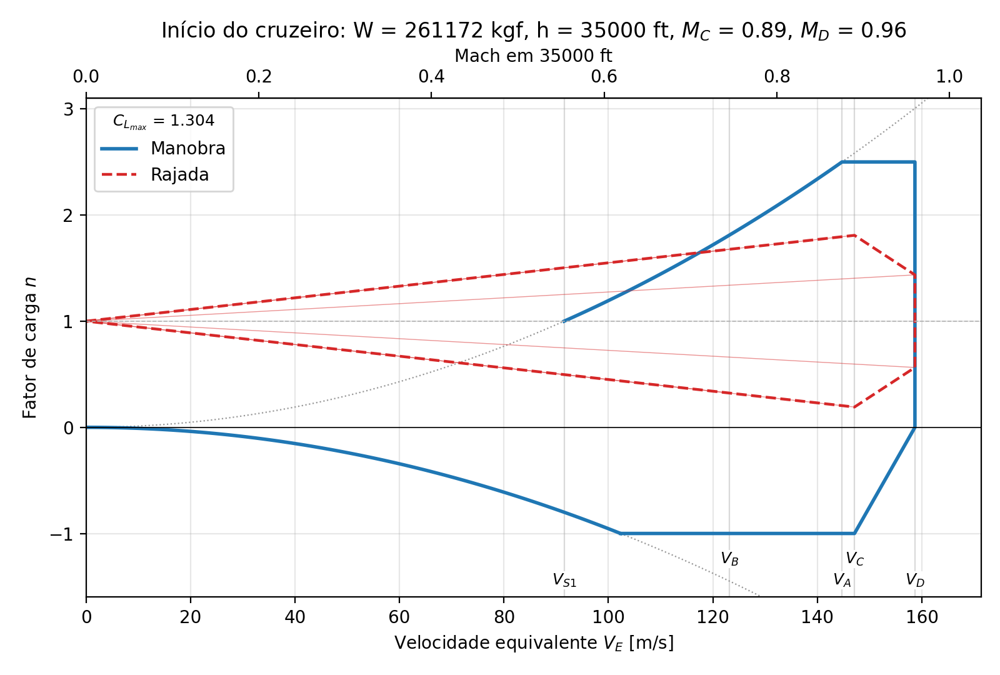
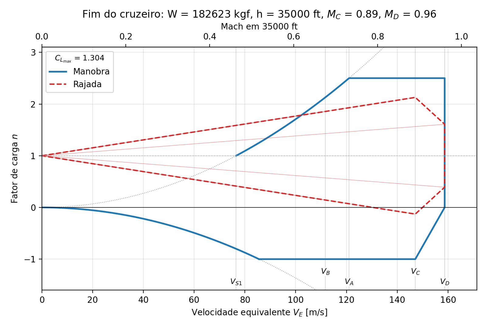
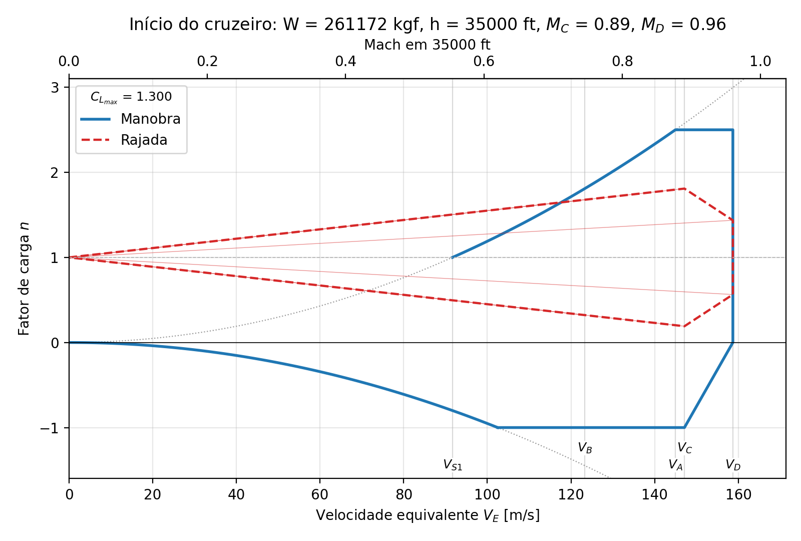
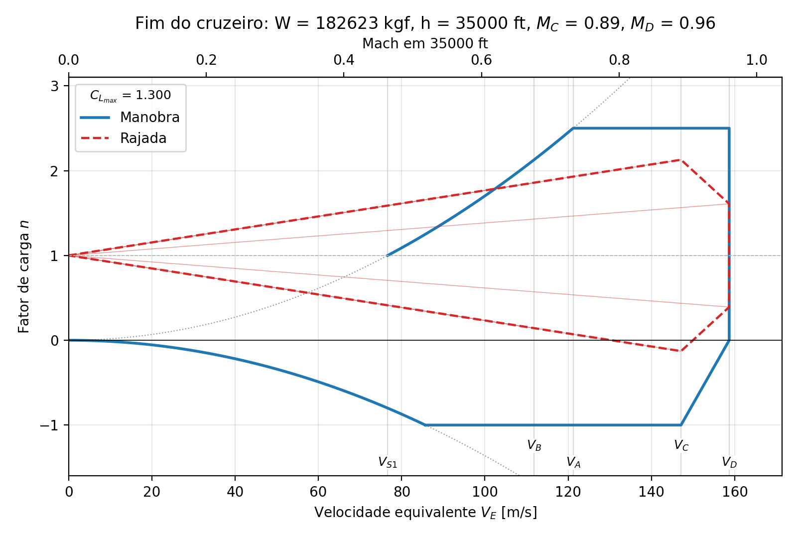
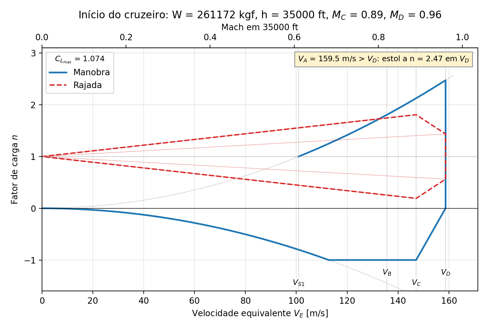
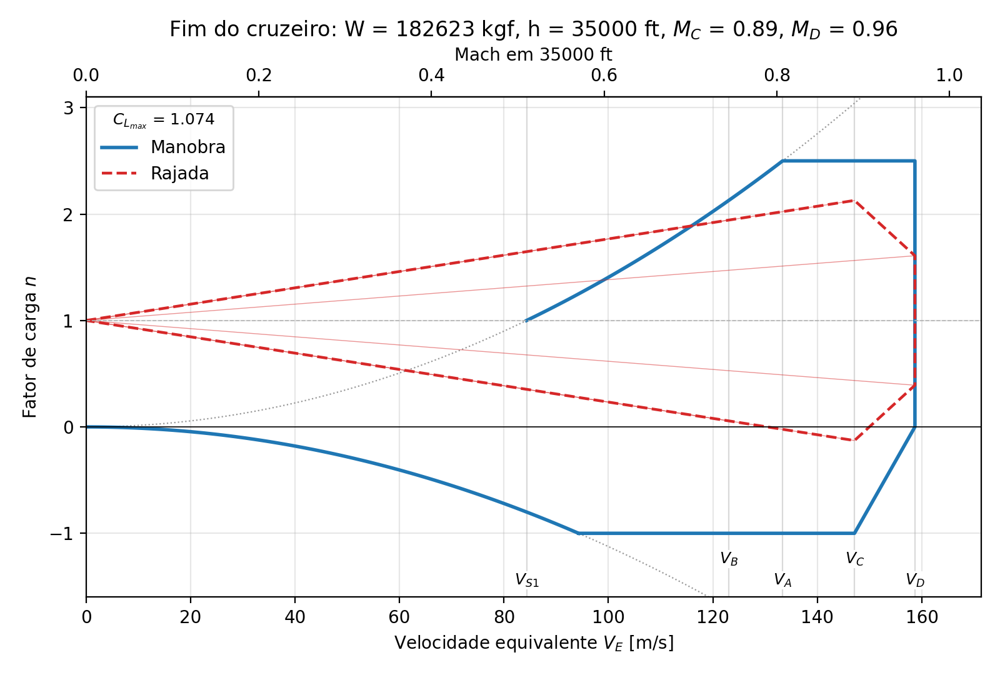

# Atividade 06 — Cargas na asa (NJ-0502)

## Item 1: Envelope de voo (diagramas V-n)

O item pede diagramas V-n para o **início** e o **fim do cruzeiro**.

| Base de cálculo | Valor |
|---|---|
| Modelo AVL | oficial, **com washout de −7°** (`fwd.avl`, commit `b8f7de4`) |
| Aeronave | `my_airplane` vigente |
| Mach de projeto de cruzeiro | **M_C = MMO = 0,89** (definido pelo professor em sala) |
| Mach de mergulho | **M_D = MMO + 0,07 = 0,96** (definido pelo professor em sala) |

Script: `q1_envelope_voo.py`. Saídas em `resultados_q1/` e `tex_q1/`.

---

### 1.1 Valores pedidos no enunciado

| Parâmetro | Símbolo | Valor | Origem |
|---|---|---|---|
| MTOW | W₀ | **273 280 kgf** (2 680 876 N) | designTool convergido (`run_1_ponto_projeto.py`, Lab 03) |
| Peso no início do cruzeiro | W_ini | **261 172 kgf** (2 562 102 N) | `fuel_weight` do designTool: W₀ × frações de partida, táxi, decolagem e subida |
| Peso no fim do cruzeiro | W_fim | **182 623 kgf** (1 791 530 N) | W_ini × Mf_cruise (Breguet) |
| Área de referência | S_ref | **382,93 m²** | `S_w` (é também o Sref do AVL) |
| Corda de referência | c_ref | **6,904 m** | corda média aerodinâmica (Cref do AVL) |
| Altitude de cruzeiro | h | **35 000 ft** (10 668 m) | `altitude_cruise` |
| Máximo coeficiente de sustentação | C_Lmax | **1,304** | designTool: 0,9·cl_max·cosΛ (ver ponto em aberto 1) |
| Mínimo coeficiente de sustentação | C_Lmin | **−1,043** | hipótese −0,8·C_Lmax (ver ponto em aberto 2) |
| Inclinação da curva de sustentação | C_Lα | **7,059 rad⁻¹** (0,1232 /°) em M 0,89, usada na rajada | AVL, avião completo, `fwd.avl` −7°, i_t = −1,143° |
| ″ (registro) | C_Lα | 6,754 rad⁻¹ (0,1179 /°) em M 0,85 | idem, no Mach de cruzeiro |
| Mach de cruzeiro | M_cr | **0,85** | `Mach_cruise` (ponto de projeto) |
| Mach de projeto de cruzeiro | M_C = MMO | **0,89** | definido pelo professor |
| Mach de mergulho | M_D | **0,96** | MMO + 0,07, definido pelo professor |
| Velocidade de rajada de referência | U_ref | **10,28 m/s EAS** (33,72 ft/s) | FAR 25.341(a)(5)(i) a 35 000 ft |

Atmosfera ISA a 35 000 ft: ρ = 0,3805 kg/m³, a = 296,59 m/s, σ = 0,3106.

### 1.2 Pontos do diagrama

As velocidades estão em EAS, que é o eixo do diagrama. A TAS e o Mach são
os valores a 35 000 ft.

| Ponto | Início EAS [m/s] | Início TAS [m/s] | Início Mach | Fim EAS [m/s] | Fim TAS [m/s] | Fim Mach |
|---|---|---|---|---|---|---|
| V_S1 (estol, n = 1) | 91,5 | 164,2 | 0,554 | 76,5 | 137,3 | 0,463 |
| V_S⁻ (estol negativo em n = −1) | 102,3 | 183,6 | 0,619 | 85,6 | 153,5 | 0,518 |
| **V_A (manobra)** | **144,7** | **259,7** | **0,876** | **121,0** | **217,1** | **0,732** |
| V_B (rajada máxima) | 123,1 | 220,9 | 0,745 | 111,7 | 200,3 | 0,676 |
| V_C (MMO) | 147,1 | 264,0 | 0,890 | 147,1 | 264,0 | 0,890 |
| V_D | 158,7 | 284,7 | 0,960 | 158,7 | 284,7 | 0,960 |

| Grandeza | Início do cruzeiro | Fim do cruzeiro |
|---|---|---|
| W/S | 6 691 Pa | 4 678 Pa |
| n_max / n_min | 2,5 / −1,0 | 2,5 / −1,0 |
| μ_g (razão de massa) | 84,5 | 59,1 |
| K_g (fator de alívio) | 0,828 | 0,808 |
| n de rajada em V_B (+/−) | 1,68 / 0,32 | 1,86 / 0,14 |
| n de rajada em V_C (+/−) | 1,81 / 0,19 | 2,13 / −0,13 |
| n de rajada em V_D (+/−) | 1,44 / 0,56 | 1,61 / 0,39 |
| n na linha de estol em V_C | 2,58 | 3,69 |

**Leitura dos diagramas:**

- A **manobra (2,5 g) domina a rajada** nas duas condições. A rajada
  máxima é 1,81 g no início e 2,13 g no fim, ambas em V_C. O fim do
  cruzeiro tem rajada maior porque está mais leve: menor W/S, logo maior Δn.
- Com M_C = 0,89, os **dois diagramas têm a forma clássica**,
  V_S1 < V_B < V_A < V_C < V_D.
- No início do cruzeiro, porém, V_A fica **colado em V_C**: 144,7 contra
  147,1 m/s EAS, M 0,876 contra 0,890. A linha de estol cruza V_C em 2,58 g,
  só 3% acima de n_max.
- Com o M_C = 0,85 usado antes, V_A ficava acima de V_C.

Figuras: `resultados_q1/vn_inicio.png` e `resultados_q1/vn_fim.png`.




### 1.2b Variantes de C_Lmax (1,30 e AVL)

Os mesmos diagramas foram refeitos com dois outros C_Lmax:

- **1,30**, valor redondo;
- **1,074**, do AVL: seção crítica do Lab 04, asa −7°, CG dianteiro
  trimado.

Os dois são a base para decidir o ponto em aberto 1. Pesos, Machs, C_Lα e
U_ref são os mesmos da versão oficial. Em cada variante, C_Lmin continua
−0,8·C_Lmax.

As variantes saem do JSON oficial sem rodar AVL nem designTool
(`--clmax 1.3` e `--clmax avl`). As saídas ficam em
`resultados_q1/clmax_1p30/` e `resultados_q1/clmax_avl/`.

| Grandeza [m/s EAS] | C_Lmax 1,304 (oficial), início | C_Lmax 1,304, fim | **C_Lmax 1,30**, início | **C_Lmax 1,30**, fim | **C_Lmax AVL 1,074**, início | **C_Lmax AVL 1,074**, fim |
|---|---|---|---|---|---|---|
| C_Lmin | −1,043 | −1,043 | −1,040 | −1,040 | −0,859 | −0,859 |
| V_S1 | 91,5 | 76,5 | 91,7 | 76,7 | 100,9 | 84,3 |
| V_S⁻ (n = −1) | 102,3 | 85,6 | 102,5 | 85,7 | 112,8 | 94,3 |
| **V_A** | **144,7** (M 0,876) | **121,0** (M 0,732) | **144,9** (M 0,877) | **121,2** (M 0,733) | **159,5 (M 0,965) > V_D** | **133,4** (M 0,807) |
| V_B | 123,1 | 111,7 | 123,3 | 111,8 | 135,7 | 123,0 |
| V_C / V_D | 147,1 / 158,7 | idem | idem | idem | idem | idem |
| n na linha de estol em V_C | 2,58 | 3,69 | 2,58 | 3,69 | 2,13 | 3,04 |
| n na linha de estol em V_D | > 2,5 | > 2,5 | > 2,5 | > 2,5 | **2,47** | > 2,5 |
| n de rajada em V_B | 1,68 | 1,86 | 1,68 | 1,86 | 1,75 | 1,94 |

**Leitura:**

- **1,30 × 1,304:** é praticamente o mesmo diagrama. V_A muda 0,2 m/s
  (+0,15%) e todos os Mach ficam na 3ª casa. Para o item 2 tanto faz;
  arredondar só deixa o número mais limpo no relatório.
- **C_Lmax do AVL, início do cruzeiro:** a linha de estol cruza V_C em
  2,13 g e chega a **2,47 g em V_D**, a 1% de n_max. Pela definição,
  **V_A não existe**: ficaria em 159,5 m/s, 0,5% além de V_D. O contorno
  positivo é a própria linha de estol até V_D, e a figura tem um aviso
  amarelo indicando isso.
  - Na prática, a condição de manobra mais severa seria o canto V_D / 2,47 g,
    em M 0,96.
  - Para o item 2, isso significaria simular o AVL em M 0,96 (fora da
    validade de um método potencial linear) ou usar n = 2,47 em vez de 2,5.
- **C_Lmax do AVL, fim do cruzeiro:** o diagrama é clássico. V_A sobe de
  121,0 para 133,4 m/s EAS (M 0,807 em vez de 0,732), ainda abaixo de V_C.
- A rajada em V_C e V_D **não muda** com C_Lmax: ela só depende de W/S, C_Lα
  e U_ref. Só V_B, que é ligado à linha de estol, se desloca. Com o AVL, a
  rajada em V_B sobe para 1,75 g e 1,94 g, ainda abaixo de 2,5 g.

**C_Lmax = 1,30:**




**C_Lmax do AVL = 1,074:**




---

### 1.3 Como foi construído

Segue a FAR/CS-25 e trabalha com velocidade equivalente (EAS). Nessa
escala a linha de estol não depende da altitude. A altitude entra em três
lugares:

- V_C e V_D, que são fixados em Mach;
- a razão de massa μ_g da rajada;
- a conversão EAS → TAS.

**a) Pesos.** O script chama a mesma rotina do ponto de projeto do Lab 03 e
do Lab 04 (`run_1_ponto_projeto.run()`):

1. converge o W₀ do `my_airplane`;
2. roda `fuel_weight` com histórico de frações de massa;
3. calcula W_ini, o peso após a subida;
4. calcula W_fim = W_ini·Mf_cruise.

O ponto de projeto do Lab 04 é a média desses dois pesos (221 898 kgf),
portanto os três números saem da mesma fonte.

**b) Fatores de carga de manobra (FAR 25.337).**

- n_max = 2,1 + 24 000/(W[lb] + 10 000), limitado a [2,5; 3,8]. Para
  W_ini ≈ 5,76×10⁵ lb a fórmula dá 2,14, então vale o piso de **2,5**.
- n_min = **−1,0** até V_C, subindo linearmente até **0** em V_D.

**c) Linhas de estol.**

- Estol positivo: n = ρ₀V_E²S·C_Lmax/(2W).
- Estol negativo: mesma expressão com C_Lmin.
- V_S1 = √(2W/(ρ₀S·C_Lmax)).
- V_A = V_S1·√n_max, que é o cruzamento da linha de estol com n_max.

**d) Velocidades de projeto (definidas pelo professor em sala).**

| Velocidade | Mach | TAS a 35 000 ft | EAS |
|---|---|---|---|
| V_C | M_C = MMO = 0,89 | 264,0 m/s | 147,1 m/s |
| V_D | M_D = MMO + 0,07 = 0,96 | 284,7 m/s | 158,7 m/s |

A margem de 0,07 é maior que o mínimo de 0,05 da FAR 25.335(b)(2).
O Mach de cruzeiro (0,85) continua sendo o do ponto de projeto, mas não
define V_C.

**e) Rajada (FAR 25.341, fórmula de Pratt).**

- U_ref é interpolado linearmente: 56 ft/s EAS ao nível do mar → 44 ft/s a
  15 000 ft → 20,86 ft/s a 60 000 ft. A 35 000 ft dá 33,72 ft/s.
- Vale U_ref em V_B e V_C, e U_ref/2 em V_D.
- Fórmulas:

  ```
  μ_g = 2(W/S) / (ρ · c̄ · C_Lα · g)        ρ na altitude; c̄ = S/b = 6,013 m (corda média geométrica)
  K_g = 0,88 μ_g / (5,3 + μ_g)
  Δn  = K_g · ρ₀ · U_de · V_E · C_Lα / (2 W/S)
  V_B = V_S1 · √(1 + Δn(V_C, U_ref))        (25.335(d)), limitada a V_C
  ```

- As retas de rajada saem de (0; 1) e passam por 1 ± Δn em V_B, V_C e V_D.
  O polígono tracejado no gráfico liga esses pontos.

**f) C_Lα pelo AVL.** São duas rodadas no `fwd.avl` oficial (asa −7°), com
i_t = −1,143° e todos os controles travados, em dois Mach:

| α (fuselagem) | C_L em M 0,85 | C_L em M 0,89 |
|---|---|---|
| 0° | 0,2300 | 0,2436 |
| 2° | 0,4657 | 0,4900 |
| **C_Lα** | **6,754 rad⁻¹** | **7,059 rad⁻¹** |

- A rajada usa o C_Lα em **M_C = 0,89**, porque é onde ela é avaliada. É
  4,5% maior que em M 0,85, logo mais conservador.
- Verificação cruzada: com a reta de M 0,85, o C_L de cruzeiro do Lab 04
  (0,4702) cai em α = 2,04°. É exatamente o valor que o README do Lab 04
  registra para a asa com −7°.
- O i_t vem de `lab04_aero/resultados_washout/tabela_washout.csv`, na linha
  de −7°. O script lê a torção da última seção da `Wing` no `fwd.avl` e
  escolhe a linha correspondente. Se o modelo voltar a ser a asa reta, ele
  usa o i_t do item 3 do Lab 04 (−3,429°).

---

### 1.4 Pontos em aberto / duvidosos

**1. Qual C_Lmax usar (decisão da equipe; muda o item 2).**

| Fonte | C_Lmax | V_A início | V_A fim |
|---|---|---|---|
| designTool, 0,9·cl_max·cosΛ (**adotado**) | 1,304 | 144,7 m/s EAS (M 0,876) | 121,0 m/s EAS (M 0,732) |
| AVL, seção crítica, asa −7°, CG dianteiro trimado (Lab 04) | 1,074 | 159,5 m/s EAS (M 0,965): **0,5% além de V_D** | 133,4 m/s EAS (M 0,807) |
| AVL, seção crítica, asa reta (superado) | 0,854 | não existe (estol a 1,97 g em V_D) | 149,6 m/s EAS (M 0,905) |

- O valor do AVL (1,074) é o resultado da própria equipe para a asa oficial
  e provavelmente é o que o professor espera ver ("máximo coeficiente de
  sustentação" vem logo depois do Lab 04).
- Com ele e o novo M_D, no início do cruzeiro a linha de estol chega a
  **2,475 g em V_D**, quase n_max.
- A rigor, o ponto A não existe. Na prática, ele coincidiria com o canto
  V_D/n_max, em M 0,96, onde o AVL (potencial linear, sem choque) não é
  representativo.
- Com 1,304 o ponto A fica num Mach mais razoável (0,876).
- Os diagramas das duas alternativas (1,30 e AVL) estão na Seção 1.2b.
- Para tornar o AVL a versão oficial (tabelas LaTeX inclusive), mude
  `CLMAX_FONTE = 'avl_q4'` no script e rode de novo.
- **Pergunta para o professor:** qual C_Lmax ele quer no V-n, o do designTool
  ou o da seção crítica do Lab 04?

**2. C_Lmin é hipótese, não cálculo.**

- Adotamos C_Lmin = −0,8·C_Lmax = −1,043 (`RAZAO_CLMIN`).
- Não há polar do perfil do Lab 03 em α negativo, e o `xfoil.exe` do
  repositório só roda no Windows.
- O perfil tem α_zl ≈ −0,08°, quase sem arqueamento efetivo, então a razão
  real pode ser mais próxima de 1.
- **Não afeta os itens 2 e 3:** a linha de estol negativo só define o
  contorno abaixo de ~100 m/s EAS. Para fechar de verdade, rode o XFOIL em
  α negativo no Windows e aplique o método da seção crítica com cl_min.

**3. C_Lmax constante com o Mach.** O mesmo C_Lmax (de baixa velocidade) foi
usado até M 0,96. Em transônico o C_Lmax real cai (buffet), então a linha de
estol perto de V_C/V_D é otimista. Isso reforça o ponto 1.

**4. O cruzeiro de alta velocidade do designTool passa do MMO.**

- O `Mach_maxcruise` do designTool é 0,90 a 30 000 ft, acima do MMO = 0,89
  definido em sala.
- Vale comentar no relatório, ou baixar o `Mach_maxcruise` para 0,89.
- Isso não muda o V-n.

**5. Rajada: fórmula estática de Pratt × rajada discreta "1-cosseno".**

- A FAR 25.341(a) vigente pede rajada discreta com análise dinâmica. A
  fórmula de Pratt é a aproximação clássica para o diagrama V-n.
- Também usamos o fator de alívio de perfil de voo F_g = 1, que é
  conservador: U_de = U_ref.
- Como a rajada não é crítica (1,81 g e 2,13 g contra 2,5 g), a escolha não
  muda a condição de projeto.

**6. Qual C_Lα na rajada.**

- Usamos o do avião completo (asa + EH + fuselagem, AVL) em M_C = 0,89, e
  esse mesmo valor em V_B e V_D.
- Em V_D (M 0,96) o Prandtl-Glauert do AVL daria um C_Lα ainda maior, mas
  nesse Mach a teoria linear já não vale.
- A fórmula clássica às vezes usa só o C_Lα da asa.
- Usando o C_Lα de M 0,85, o Δn cairia ~4% (a rajada em V_C no fim do
  cruzeiro iria de 2,13 g para ~2,08 g). A conclusão não muda.

**7. c̄ em μ_g.** Usamos a corda média geométrica S/b = 6,013 m, que é o
que a 25.341 define. Com a CMA (6,904 m), μ_g cai ~13%, K_g cai junto e o
Δn diminui ~1%. Ou seja, a escolha atual é a mais conservadora das duas.

**8. Avisos para o item 2.**

- No início do cruzeiro, V_A está em **M 0,876**, acima do Mach de cruzeiro
  e quase no MMO. O AVL aplica Prandtl-Glauert nesse Mach, mas sem onda de
  choque, então a distribuição de cℓ é uma aproximação.
- Com C_Lmax = 1,304, atingir n = 2,5 em V_A exige C_L = C_Lmax por
  construção. Pela reta do AVL, isso dá **α ≈ 9° de fuselagem** (asa a
  ~13,5° na raiz).
- O AVL não estola, então ele vai entregar a solução. Mesmo assim, vale
  conferir cℓ/cℓ_max ao longo da envergadura e comentar no relatório.
- Taxa de arfagem do enunciado, q = g(n−1)/V_TAS:
  - início do cruzeiro: q = 0,0567 rad/s;
  - fim do cruzeiro: q = 0,0677 rad/s.
- **V_A não mudou com o novo M_C/M_D:** ele só depende de W, S, C_Lmax e
  n_max. Por isso as condições do item 2 são as mesmas.

**9. CG.**

- O C_Lα e o i_t usados são os do **CG dianteiro** (`fwd.avl`).
- No `aft.avl`, i_t = +0,330° com a asa torcida: a EH passa a sustentar.
- O C_Lα do avião muda pouco entre os dois CGs.
- Falta decidir em qual CG simular o item 2. O dianteiro dá maior carga
  descendente na EH, logo maior sustentação na asa, e tende a ser o caso
  crítico para a flexão da asa.

---

### 1.5 Histórico que afeta este item

| Mudança | O que mudou | O que não mudou |
|---|---|---|
| **M_C/M_D definidos em sala** (M_C = MMO = 0,89; M_D = 0,96) | Antes: M_C = M_cr = 0,85 e M_D = 0,90. Mudam V_C (140,5 → 147,1 m/s EAS), V_D (148,8 → 158,7), V_B, todo o envelope de rajada e o C_Lα da rajada (6,754 → 7,059 rad⁻¹). | Pesos, V_S1 e V_A |
| **`b8f7de4` (22/10)**: `fwd.avl`/`aft.avl` viraram a asa com washout −7° e os `*_washout.avl` foram removidos | A primeira rodada foi com a asa reta (C_Lα = 6,735 rad⁻¹ em M 0,85, i_t = −3,429°). Diferença < 0,3% em C_Lα. | — |

A asa reta agora existe só como cópia local (`fwd_reta.avl`/`aft_reta.avl`,
no `.gitignore`).

---

### 1.6 Como rodar

```bash
cd designTool/lab06_cargas
python q1_envelope_voo.py         # roda designTool + AVL e grava tudo
python q1_envelope_voo.py --tex   # refaz figuras/tabelas a partir do JSON
python q1_envelope_voo.py --clmax 1.3   # variante C_Lmax = 1,30  -> resultados_q1/clmax_1p30/
python q1_envelope_voo.py --clmax avl   # variante C_Lmax do AVL  -> resultados_q1/clmax_avl/
```

As variantes leem o `q1_envelope.json` oficial. Rode o comando sem opções
primeiro sempre que o modelo mudar.

O AVL é chamado por `lab04_aero/avl_tools.py`, que agora escolhe o binário
pela plataforma: `AVL_package/avl337.exe` no Windows e `AVL_package/avl`
(nativo arm64) no macOS.

| Arquivo | Conteúdo |
|---|---|
| `resultados_q1/q1_envelope.json` | todos os dados de entrada e resultados |
| `resultados_q1/q1_pontos_vn.csv` | velocidades características (EAS, TAS, Mach, kt) |
| `resultados_q1/vn_inicio.png`, `vn_fim.png` | diagramas V-n (C_Lmax oficial, 1,304) |
| `resultados_q1/clmax_1p30/` | variante C_Lmax = 1,30: JSON, CSV e as duas figuras |
| `resultados_q1/clmax_avl/` | variante C_Lmax do AVL (1,074): JSON, CSV e as duas figuras |
| `tex_q1/tab_dados.tex` | tabela 1.1 em LaTeX (para o relatório) |
| `tex_q1/tab_velocidades.tex` | tabela 1.2 em LaTeX |

Parâmetros no topo do script: `CLMAX_FONTE`, `RAZAO_CLMIN`, `MMO`,
`DELTA_MD`.
